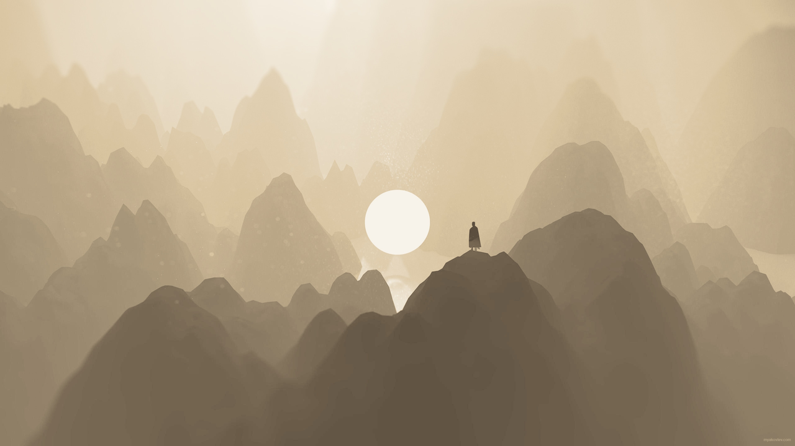

# Solitude Dawn

The light companion to [Solitude Dusk](https://github.com/iam-wisman/solitude-dusk),
an [Omarchy](https://omarchy.org) theme. Where Dusk is charcoal and a setting sun,
Dawn is warm paper and the first amber light of the morning. The same quiet palette
carries over, darkened so every colour stays readable on a light background, and the
same single accent ties it together: the cursor, the window border and the selection.



## Install

```bash
git clone https://github.com/iam-wisman/solitude-dawn
./solitude-dawn/install.sh
```

Use the script rather than `omarchy theme install`. Omarchy treats a theme that
still has its `.git` folder as third-party and skips its Hyprland, terminal and
Neovim configs every time it is applied, so the gradient border, animations and
Kitty cursor trail would be lost. `install.sh`:

- installs the theme as a plain folder so Omarchy applies every file
- installs the GTK3 and GTK4 templates and their `theme-set` hooks, so GTK,
  libadwaita and Qt apps follow the theme (see below)
- adds a `theme-set` hook that applies the theme's eza colours for `ls`
  (and removes them again when you switch to a theme without any)
- adds a `theme-set` hook that installs the VS Code theme into every profile
- turns on the Kitty cursor blink that Omarchy's default `kitty.conf` disables
- installs the Bibata Modern Amber cursor (v2.0.7, checksum-verified) from the
  [official GitHub release](https://github.com/ful1e5/Bibata_Cursor/releases)
  into `~/.local/share/icons` and switches to it at size 16 right away
- installs the desktop customisations below (skip them with `--theme-only`)
- applies the theme and sets the default wallpaper

It is safe to re-run, and backs up any file it changes outside the theme to
`~/.local/state/solitude-dawn/backups/`.

## GTK, libadwaita and Qt apps

Omarchy switches GTK and libadwaita apps between their stock light and dark
styles, but leaves their colours alone. Dawn ships two templates that Omarchy
renders from `colors.toml` on every theme change, plus a hook for each that
installs the result:

| Toolkit | Template | Installed to | Apps |
|---------|----------|--------------|------|
| GTK4 / libadwaita | `extras/themed/gtk4.css.tpl` | `~/.config/gtk-4.0/gtk.css` | Nautilus, Settings, Loupe, Text Editor |
| GTK3 | `extras/themed/gtk.css.tpl` | `~/.config/gtk-3.0/gtk.css` | virt-manager, Thunar, older GTK apps |
| Qt 6 | (reads GTK3) | | OBS, Kdenlive, pinentry-qt |

Qt apps need nothing extra: Omarchy sets `QT_QPA_PLATFORMTHEME=gtk3`, so Qt
takes its palette from the GTK3 stylesheet above.

The templates use colour names, not fixed values, so they work for every
Omarchy theme, not just this one: switch to Dusk, Catppuccin or anything else
and GTK, libadwaita and Qt apps follow. Both hooks only ever replace or remove a
`gtk.css` they created themselves; a hand-written one is left alone. Apps that
are already open pick up the new colours the next time they start.

Flatpak apps are sandboxed and don't read these files unless you grant them
access with `flatpak override --user --filesystem=xdg-config/gtk-4.0:ro`
(and `gtk-3.0`).

## Desktop customisations

These are Omarchy shell plugins, kept in `extras/plugins/` and copied to
`~/.config/omarchy/plugins/`. The bar section of `~/.config/omarchy/shell.json`
is replaced with `extras/shell/bar.json`, which selects them and holds the bar
layout; the rest of `shell.json` (idle timers and so on) is left alone.

- **`wuisman.bar`:** a clone of Omarchy's bar that stays on the top edge but
  is inset 10px on each side (Hyprland's `gaps_out`) so it lines up with a
  full-width window, with its bottom corners rounded to 6px like the windows
- **`wuisman.kitten`:** replaces the Omarchy logo with a square kitten
  (`kitten.svg`), drawn in the bar's text colour so it reads on light and dark
  themes alike. Left click opens the Omarchy menu, right click a terminal
- **`wuisman.workspaces`:** a clone of the workspace switcher coloured from
  whichever theme is active: accent for the focused workspace, text colour for
  occupied ones, muted for empty ones, and the theme's red for urgent ones

The plugins are shared with Solitude Dusk, so installing either theme sets up the
same bar.

## Palette

| Role | Colour | Note |
|------|--------|------|
| Background | `#f4f0e8` | warm paper |
| Panels | `#ebe6dc` / `#e2dccf` | a shade deeper for side bars and the bar |
| Text | `#2f2c28` / `#1a1816` | warm ink |
| Muted | `#8f8a80` | comments, empty workspaces |
| Accent | `#b06f00` | the rising sun |

Dusk's sun gold `#db9617` is too faint on paper to read as text, so Dawn's accent
is a deeper amber. Every ANSI colour is Dusk's evening colour darkened to at least
a 3.5:1 contrast ratio against the background:

| Slot | Normal | Bright |
|------|--------|--------|
| red | `#a8452a` rust | `#c0674a` |
| green | `#64693c` olive | `#80855a` |
| yellow | `#a86a00` amber | `#c88a10` |
| blue | `#566078` slate | `#707a92` |
| magenta | `#7d5c79` mauve | `#957592` |
| cyan | `#4b6b63` sage | `#66857d` |

## What's in the theme

- **Kitty:** font size 10, amber cursor with an amber cursor trail and a smooth
  ease-in-out blink, copy on select. Black stays dark and white stays light, so
  program output that uses them remains visible
- **ls:** an `eza.yml` theme (directories slate, executables amber, git status,
  permissions and sizes graded through the palette)
- **Window borders:** 1px "dawn glow", an amber to coral 45 degree gradient on the
  active window; inactive borders in paper grey `#d9d2c4`
- **Hyprland:** 6px rounding, blur, a soft warm shadow and the slide and pop-in
  animations from Solitude Dusk
- **Mouse cursor:** [Bibata Modern Amber](https://github.com/ful1e5/Bibata_Cursor) at size 16
- **Icons:** Yaru-yellow, the light version of Dusk's Yaru-yellow-dark
- **Neovim:** [flexoki-light](https://github.com/kepano/flexoki-neovim), a warm
  paper colour scheme (Dusk's ashen has no light variant)
- **VS Code:** its own Solitude Dawn colour theme (see below)
- **Wallpapers:** five of Dusk's wallpapers, toned to warm sepia
- **Lock screen:** the Omarchy logo in warm ink on paper

Everything else (Alacritty, Ghostty, Foot, btop, the bar, Chromium and so on) is
generated by Omarchy from `colors.toml`.

## VS Code

`extras/vscode/` is a VS Code theme extension, `iam-wisman.solitude-dawn`:
editor `#f4f0e8`, side bar, title bar, status bar and panel a shade deeper at
`#ebe6dc`, amber cursor, amber top edge on the active tab, and the palette's
daylight colours for syntax. It is Solitude Dusk's VS Code theme with every
colour mapped to its Dawn counterpart.

It is not on the Marketplace, so the theme carries the packaged
`solitude-dawn-1.0.0.vsix`, and the `vscode-profiles` theme-set hook:

- installs it into Default and every VS Code profile that doesn't have it yet
- sets every profile's colour theme to Default's, so all profiles follow
  whatever Omarchy theme is active (Omarchy itself only themes Default)

`install.sh` backs up every profile's `settings.json` first.

To rebuild the VSIX after editing `themes/solitude-dawn-color-theme.json`,
bump `version` in `package.json` and `VSCODE_VSIX` in `install.sh`, then:

```bash
cd extras/vscode
npx @vscode/vsce package -o solitude-dawn-<version>.vsix
```

## Wallpaper credits

The wallpapers are sepia-toned versions of Solitude Dusk's, from wallhaven.cc:

| File | Source |
|------|--------|
| `dawn-01.jpg` | https://wallhaven.cc/w/85z1o1 |
| `dawn-02.jpg` | https://wallhaven.cc/w/8g5p52 |
| `dawn-03.jpg` | https://wallhaven.cc/w/qrdy1l |
| `dawn-04.jpg` | https://wallhaven.cc/w/768zy3 |
| `dawn-05.jpg` | https://wallhaven.cc/w/d8p7w3 |

To regenerate them from the Dusk originals:

```bash
magick -size 1x128 gradient:'#4f4234'-'#d9c4a0' \
       -size 1x128 gradient:'#d9c4a0'-'#f8f3ea' -append clut.png
magick dusk.jpg -resize '3840x2160^' -colorspace gray -level 0%,100%,1.35 \
       -colorspace sRGB -type TrueColor clut.png -clut -quality 92 dawn.jpg
```
